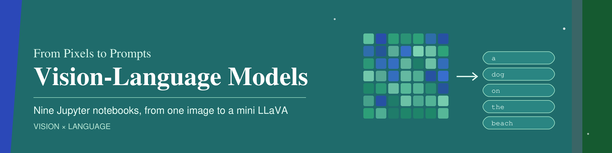
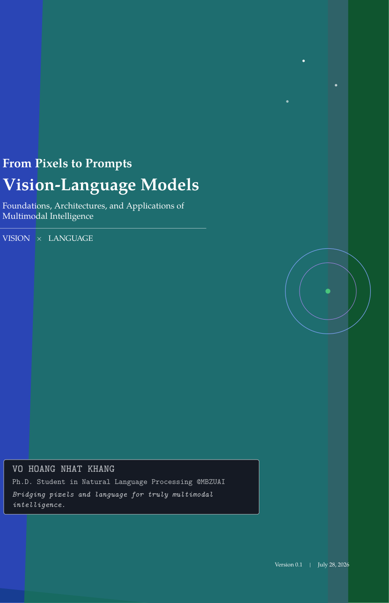

<div align="center">



<br>

[](https://arxiv.org/abs/2605.07544)
[](https://www.python.org/)
[](https://pytorch.org/)
[](https://github.com/huggingface/transformers)
[](notebooks/)

[](https://github.com/nhatkhangcs/educational_vlm)
[](https://github.com/nhatkhangcs/educational_vlm/network/members)
[](https://github.com/nhatkhangcs/educational_vlm/commits/main)
[](https://github.com/nhatkhangcs/educational_vlm/graphs/commit-activity)
[](https://github.com/nhatkhangcs/educational_vlm/issues)

**[Read the book](https://arxiv.org/abs/2605.07544)** ·
**[See the notebooks](#whats-inside)** ·
**[Run them yourself](#running-them-yourself)** ·
**[Cite](#citing-this-work)**

</div>

---

<a href="https://arxiv.org/abs/2605.07544"></a>

This is the companion code for [*From Pixels to Prompts: Vision-Language Models*](https://arxiv.org/abs/2605.07544), a book about how models like CLIP and LLaVA connect images and language. The book explains the ideas. Here you get to build them, one notebook at a time.

You'll start with a single photo and watch it turn into a list of numbers. From there you'll match images with captions, train a tiny CLIP from scratch, search photos with text, write captions, and answer questions about pictures. At the end you'll hook a vision model up to a real language model, so it can answer questions about a photo in full sentences.

If you know some Python and have trained a model or two in PyTorch, you're ready. You don't need any background in computer vision or NLP.

There are nine notebooks in all, with 34 "pause and predict" questions, 28 longer exercises, and 22 figures taken from the book and the original papers.

<br clear="right">

## What's inside

Go through them in order, since each one picks up where the last one left off. The times are from our own machine, with everything already downloaded.

| | Notebook | What you'll do | On a GPU | On a CPU |
|:-:|---|---|:-:|:-:|
| 01 | [How does a computer *see* an image?](notebooks/01_images_become_vectors.ipynb) | Follow one CIFAR-10 photo through CLIP's vision encoder, from raw pixels to a 512-number vector. | < 1 min | < 1 min |
| 02 | [How does a computer *read* a sentence?](notebooks/02_text_becomes_vectors.ipynb) | Split a few news articles into tokens and turn each one into a vector with CLIP's text side. | < 1 min | < 1 min |
| 03 | [How does CLIP know which caption goes with which photo?](notebooks/03_image_text_similarity.ipynb) | Score photos against captions, and rebuild CLIP's training loss one line at a time from the paper. | < 1 min | < 1 min |
| 04 | [Can we train a tiny CLIP ourselves?](notebooks/04_miniclip_from_scratch.ipynb) | Build a small CLIP, train it from scratch on 800 image–caption pairs, and see what it learned. | < 1 min | ~ 18 min |
| 05 | [Can CLIP sort images into classes it was never trained on?](notebooks/05_zero_shot_classification.ipynb) | Classify images without any training, just by comparing them with sentences like "A photo of a cat." | < 1 min | < 1 min |
| 06 | [Can we search photos with a sentence?](notebooks/06_image_text_retrieval.ipynb) | Search a small photo collection with a caption, search captions with a photo, and score how well both work. | < 1 min | < 1 min |
| 07 | [How does a model *write* about an image?](notebooks/07_captioning_with_cross_attention.ipynb) | Train a tiny captioner that looks at the image while it writes, one word at a time. | < 1 min | ~ 5 min |
| 08 | [Can a model answer a question about a picture?](notebooks/08_mini_vqa.ipynb) | Combine what CLIP sees in the image with what it reads in the question, and pick an answer. | < 1 min | ~ 1 min |
| 09 | [How do we plug a vision model into a real language model?](notebooks/09_llava_style_connector.ipynb) | Connect CLIP to a small Qwen language model and train it the way LLaVA was trained. | a few hours | needs a GPU |

Each notebook lists the matching book sections at the top.

## How the notebooks work

Each section opens with a question, like "How does CLIP cut the image into pieces?". A few lines of code answer it, and a short explanation tells you what you just got back. When a notebook follows a paper, the paper's figures sit right next to the code they describe.

A few things come up again and again. Before some cells you'll be asked to pause and predict what's about to happen, and it really is worth guessing first. Cells marked TODO are there for you to play with: swap in a different image, write your own caption, try another prompt, and run it again. They work fine as they are, so you can skip them the first time through. Every notebook ends with a short recap, a few questions to check yourself (the answers are hidden), and some longer exercises.

## Running them yourself

```bash
git clone https://github.com/nhatkhangcs/educational_vlm.git
cd educational_vlm
pip install -r requirements.txt
jupyter notebook
```

Each notebook runs from top to bottom. The first time you run one, it downloads its data and model weights from Hugging Face. After that, everything loads from your cache.

To pick a GPU, change `GPU_ID` in the first code cell. Leave it at `"0"` if you only have one, or set it to `""` to run on the CPU instead.

One warning about notebook 09: it's a lot bigger than the others. You'll need a GPU, 35–50 GB of free disk space (the VQAv2 download alone is about 13.5 GB), and a few hours for training. It's the kind of notebook you start and then go do something else.

## Where the data comes from

Everything is pulled from the Hugging Face Hub at fixed revisions, so you'll see the same rows we did.

| Dataset | Notebooks | What's in it |
|---|:-:|---|
| [CIFAR-10](https://huggingface.co/datasets/uoft-cs/cifar10) | 01, 05 | small photos in ten classes |
| [AG News](https://huggingface.co/datasets/fancyzhx/ag_news) | 02 | news articles on four topics |
| [COCO captions (small subset)](https://huggingface.co/datasets/Erland/coco_captions_small) | 03, 04, 06, 07, 09 | photos with captions written by people |
| VQAv2 validation samples ([100 rows](https://huggingface.co/datasets/Multimodal-Fatima/VQAv2_sample_validation_100), [larger](https://huggingface.co/datasets/Multimodal-Fatima/VQAv2_sample_validation)) | 08, 09 | photos, questions, and ten human answers for each question |
| [VQAv2 training split, from The Cauldron](https://huggingface.co/datasets/HuggingFaceM4/the_cauldron) | 09 | 443,757 training questions |

## What's in the repo

```text
notebooks/        the nine notebooks
assets/diagrams/  figures used in the notebooks, from the book and the original papers
requirements.txt
```

## Found a mistake?

Please [open an issue](https://github.com/nhatkhangcs/educational_vlm/issues), or send a pull request if you already have a fix. If you edit a notebook, clear its outputs before you commit, so the next person starts with a clean copy.

## Citing this work

If this helps your work, you can cite the book:

```bibtex
@misc{vo2026pixels,
  title         = {From Pixels to Prompts: Vision-Language Models},
  author        = {Vo, Khang Nhat Hoang},
  year          = {2026},
  eprint        = {2605.07544},
  archivePrefix = {arXiv},
  url           = {https://arxiv.org/abs/2605.07544}
}
```

And if you enjoyed the notebooks, a star helps other people find them.

## Star History

<a href="https://www.star-history.com/?type=date&repos=nhatkhangcs%2Feducational_vlm">
 <picture>
   <source media="(prefers-color-scheme: dark)" srcset="https://api.star-history.com/chart?repos=nhatkhangcs/educational_vlm&type=date&theme=dark&legend=top-left" />
   <source media="(prefers-color-scheme: light)" srcset="https://api.star-history.com/chart?repos=nhatkhangcs/educational_vlm&type=date&legend=top-left" />
   
 </picture>
</a>
